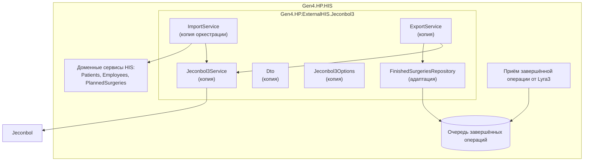
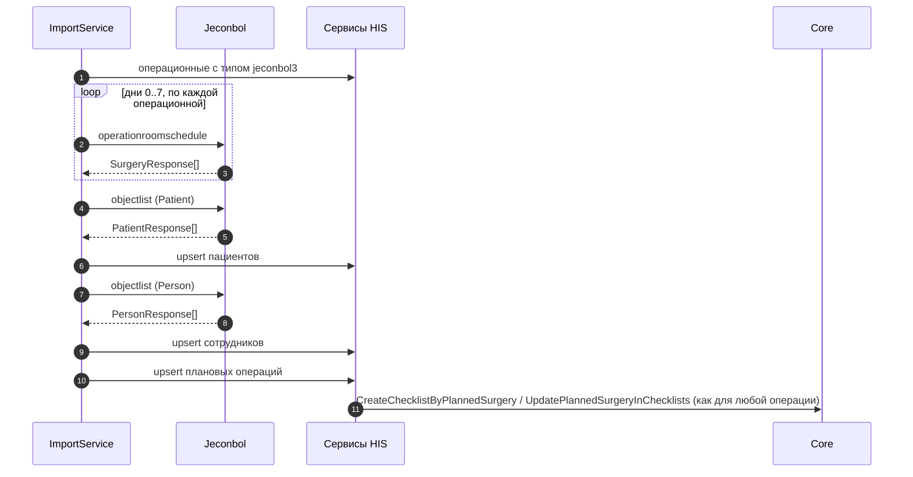
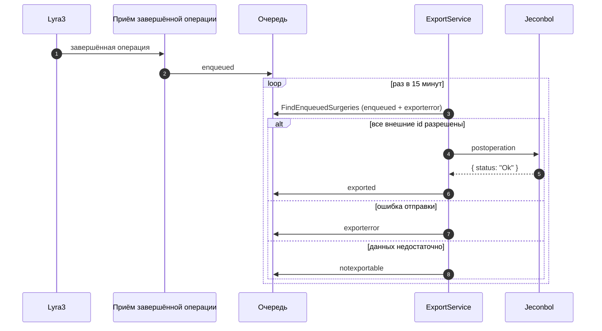

# Перенос интеграции Jeconbol из Lyra3 в Gen4

Статус: рабочая версия архитектуры. Принятые решения помечены; открытые — в конце.

Дата: 2026-11-06. Тикет: GENFHP-1600.

Принцип: **функционально ровно то, что есть в Lyra3**. Код переносится файлами; если в Gen4 не хватает эндпоинта, он делается.

Принято: подсистема живёт в `gen4.hp.his.srv`; мастер-данные импортируются в Gen4.HIS; завершённые операции остаются в Lyra3 и пробрасываются в Jeconbol через очередь; импорт пишет через доменные сервисы HIS, чтобы обновлять чек-листы; FHIR-правки — в этой же ветке.

---

## 1. Карта переноса

Эталон — `C:\Repos\Lyra3.HP.Jumbo.API`.

| Файл в Lyra3 | Куда в Gen4 | Как |
|---|---|---|
| `Src/Services/Jeconbol3/IJeconbol3Service.cs` | `Gen4.HP.ExternalHIS.Jeconbol3/Services/` | как есть |
| `Src/Services/Jeconbol3/Jeconbol3Service.cs` | там же | как есть, без `ILocalizationService` |
| `Src/DTO/Jeconbol3/**` (25 файлов) | `.../Dto/` | как есть |
| `Src/Converters/Jeconbol3BirthdateConverter.cs` | `.../Converters/` | как есть |
| `Src/ConfigOptions/Jeconbol3Options.cs` | `gen4.hp.core.srv`: `Gen4.HP.Integrations.Jeconbol3` | контракт один для Core и HIS |
| `Src/Defines.cs`, структура `Jeconbol3` | там же — контрактные значения; рантайм-константы остались в модуле (`Jeconbol3Names`) | разделено |
| `Src/Services/Jeconbol3/IImportService.cs`, `ImportService.cs` | `.../Services/` | оркестрация как есть, зависимости — сервисы HIS |
| `Src/Services/Jeconbol3/IExportService.cs`, `ExportService.cs` | `.../Services/` | как есть, источник — очередь Gen4 |
| `Src/Repositories/FinishedSurgeriesRepository.cs` | `.../Repositories/` | адаптация: EF вместо Mongo, те же методы |
| `Src/Entities/**` | — | не переносятся: в Gen4 свои сущности |
| `Jeconbol3.Emulator.API/**` | — | не переносится: эмулятор остался в Lyra3 Jumbo, стенд запускает его оттуда |
| `Tests/13_EconbolImportServiceTests.cs` | `tst/` | вместе с кодом |



### 1.1 Направление обмена

Jeconbol не знает про нас ничего: ему не передаётся ни один URL, у него нет ни вебхуков, ни обратных вызовов, ни регистрации. **Весь обмен инициирует Gen4.**

| Направление | Инициатор | Что |
|---|---|---|
| Gen4 → Jeconbol | таймер импорта | `operations/operationroomschedule`, `operations/objectlist` |
| Gen4 → Jeconbol | таймер экспорта | `operations/postoperation` |
| Jeconbol → Gen4 | — | ничего |

Следствия:

- **Styx не участвует.** Он маршрутизирует входящий трафик к сервисам Gen4; входящего трафика от Jeconbol нет.
- **Требование к сети одностороннее**: Gen4 должен достучаться до Jeconbol по `ServiceUrl`; обратный доступ не нужен.
- **Свежесть данных ограничена периодом опроса.** Событий от Jeconbol нет.
- В химере получаются две последовательные опросные ступени: Lyra3 опрашивает Gen4 по FHIR, Gen4 опрашивает Jeconbol. Изменение в Jeconbol становится видимым в Lyra3 не раньше следующего тика импорта.

---

## 2. Импорт

Логика переносится как есть:

1. `StartAsync` — при `IsEnabled` таймер: старт через 5 секунд, период `MinutesUpdateInterval`.
2. `GetSurgeries` — операционные с внешним типом `jeconbol3`, затем по каждой и по каждому дню `0..7` вызов `operations/operationroomschedule`.
3. `SaveSurgeriesPatients` — `operations/objectlist` (`Patient`), upsert.
4. `SaveSurgeriesDoctors` — `operations/objectlist` (`Person`), upsert.
5. `SaveSurgeries` — маппинг операции, разрешение пациента/врачей/операционной по внешним id, добавление или обновление.



Чек-листы для импортированных операций создаются **так же, как для любых операций Gen4**. Импорт сам чек-листы не создаёт и настройку расписания не меняет, но запись идёт через `IPlannedSurgeriesService.Add`/`Update`, поэтому дальше работает штатный механизм Core: при включённом `IsScheduledUpdateEnabled` чек-лист создаётся сразу при попадании операции в окно `1 + DaysTo` (`CreateChecklistByPlannedSurgery` → `ChecklistsService.CreateByPlannedSurgery`), а операции вне окна подхватывает ежедневный планировщик (`ChecklistScheduleService` → `CreateChecklistsByPlannedSurgeriesTime`). По умолчанию настройка выключена (`false`), и тогда чек-листы создаются только вручную — как и для операций, созданных в Gen4. Повторный импорт отредактированной в Jeconbol операции обновляет существующий чек-лист через `UpdatePlannedSurgeryInChecklists`.

**Пересечения операций проверяются так же, как в Gen4.** Если `IPlannedSurgeriesService.Add`/`Update` отклонит операцию из-за пересечения по комнате или пациенту, это не остановит цикл: в `ImportService` каждая операция обрабатывается целиком (маппинг ответа и запись) внутри собственного `try/catch`, ошибка логируется с внешним id, остальные операции обрабатываются. Так же ведёт себя Lyra3: битый элемент ответа пропускается, цикл продолжается.

Маппинг полей — переносится из `ToPatient`, `ToDoctor`, `ToPlannedSurgery`:

| Jeconbol | HIS |
|---|---|
| `PatientResponse.id` | `patient_additional_info.external_his_id` |
| `lname/fname/sname`, `bdate` | `last_name/first_name/patronymic`, `birth_date` |
| `department`, `historyNumber` | — (в Lyra3 тоже отбрасывались) |
| `PersonResponse.id` | `employee_additional_info.external_his_id` |
| `speciality`, `bdate` персоны | — (в Lyra3 тоже отбрасывались) |
| `SurgeryResponse.id` | `planned_surgery_additional_info.external_his_id` |
| `patientId`, `plannedOperationRoom` | `patient_id`, `organization_part_id` |
| `operationTypeId` | `planned_surgery_additional_info.external_surgery_type_id` |
| `operationTypeName` | `surgery_types` по совпадению `name`, иначе «НЕУКАЗ» |
| `plannedTime`, `plannedDuration` | `start`, `end` |
| участники | `surgery_team_members` + `surgery_roles` |
| `diagnosis` | `diagnoses` по совпадению, иначе «НЕУКАЗ»; исходный текст всегда в `note` |
| `plannedOperationTable` | — (в Lyra3 тоже отбрасывался) |

---

## 3. Экспорт

Переносится целиком: очередь, состояния, таймер 15 минут, проверки внешних id, `postoperation`, разбор ошибок.



Очередь — две таблицы в `his-db`: доменная `finished_surgeries` и её сателлит `finished_surgery_additional_info` (связь 1:1, каскад только от операции к сателлиту).

| Таблица | Поле | Назначение |
|---|---|---|
| `finished_surgeries` | `id` | идентификатор завершённой операции Lyra3 |
| | `planned_surgery_id` | плановая операция (nullable — операция может быть без плана) |
| | `patient_id` | пациент |
| | `operating_room_id` | операционная |
| | `start_time`, `finish_time` | время операции |
| `finished_surgery_additional_info` | `jeconbol3_export_state` | `enqueued`, `exported`, `exporterror`, `notexportable` |
| | `jeconbol3_export_error_message` | текст ошибки, до 256 символов |

---

## 4. Операционные

Как в Lyra3: импорт операционные **не создаёт**, а читает уже существующие с внешним типом `jeconbol3`. Привязка внешнего id — ручная операция администратора.

| Действие | Эндпоинт в Gen4 | Поведение |
|---|---|---|
| Привязка / перенос | `PUT /api/organization/parts/{id}` с `ExternalHisId` | только для типа `OperatingRoom`; значение должно быть GUID; запись в `operating_room_additional_info` |
| Чтение привязки | `GET /api/organization/parts/{id}`, `GET /api/organization/parts` | `externalHisId` собирается из двух таблиц, без кэша |
| Отвязка | тот же `PUT` **без** поля `externalHisId` | поле отсутствует = снять привязку (контракт с фронтом: передавать текущее значение) |
| Проверка в Jeconbol | `GET /api/organization/parts/checkExternalHisExistence/{externalHisId}` | отдельный вызов; при сохранении на сервере не проверяется (как в Lyra3 для Jeconbol) |

Дополнительные гарантии на уровне сервиса и БД:

- `externalHisId` допускается только для `OperatingRoom` (иначе 422), и только в формате GUID (иначе 400) — иначе импорт молча пропустил бы комнату;
- частичный уникальный индекс `operating_room_additional_info_external_his_uindex` на `(external_his_id, external_his_type)`; нарушение возвращает 409;
- смена типа части, у которой есть привязка, запрещена (409) — сначала отвязка.

Обе операции записи — `Master`/`Administrator`, как в Lyra3.

---

## 5. Эмулятор

Переносится целиком: `Program.cs`, `Startup.cs`, `Host/*`, `Configuration/*`, `Validation/*`, `Services/*`, `Controllers/*`, `data.yml`, Dto (ссылка на проект Gen4). Конфиг — YAML через `JECONBOL3_EMULATOR_API_CONF`, порт стенда 9097.

---

## 6. Настройки

Пять ключей: четыре как в Lyra3 плюс интервал экспорта.

```
/Configuration/Jeconbol3Options/IsEnabled
/Configuration/Jeconbol3Options/ServiceUrl
/Configuration/Jeconbol3Options/Authorization
/Configuration/Jeconbol3Options/MinutesUpdateInterval
/Configuration/Jeconbol3Options/ExportMinutesInterval
```

Модель настроек одна на два сервиса — `Gen4.HP.Integrations.Jeconbol3` в `gen4.hp.core.srv`; HIS ссылается на неё напрямую проектной ссылкой (позже — пакетом). Читаются штатным конфиг-провайдером HIS (HTTP в Core, mTLS, `AllowedKeys`, обновление по NATS) через `IOptionsMonitor`, поэтому смена `IsEnabled` и `ServiceUrl` применяется без рестарта. В `ApiDefines.Configuration.AllowedKeys` в `Gen4.HP.HIS.API` все пять ключей перечислены.

---

## 7. Классы и публичные методы

```csharp
namespace Gen4.HP.ExternalHIS.Jeconbol3;

public sealed class Jeconbol3Options
{
    public bool? IsEnabled { get; set; }
    public string? ServiceUrl { get; set; }
    public string? Authorization { get; set; }
    public int MinutesUpdateInterval { get; set; }
}

public interface IJeconbol3Service
{
    Task<PatientsListResponse> GetPatients(PatientsListRequest request);
    Task<PersonsListResponse> GetPersons(PersonsListRequest request);
    Task<SurgeriesListResponse> GetSurgeries(SurgeriesListRequest request);
    Task<ExportSurgeryResponse> SendSurgery(ExportSurgeryRequest request);
    Task<ObjectsListResponse> GetOperatingRooms(OperatingRoomsListRequest request);
    Task CheckOperatingRoomExistence(string id);
}

public interface IImportService : IHostedService
{
    Task SaveSurgeries(List<SurgeryResponse> responses);
}

public interface IExportService : IHostedService
{
}

public interface IFinishedSurgeriesRepository
{
    Task Enqueue(FinishedSurgery surgery);
    Task<IReadOnlyList<FinishedSurgery>> FindEnqueuedSurgeries();
    Task SetExported(Guid id);
    Task SetExportError(Guid id, string message);
    Task SetNotExportable(Guid id, string message);
}

public static class Jeconbol3Extensions
{
    public static Gen4WebApplicationBuilder AddJeconbol3Module(this Gen4WebApplicationBuilder builder);
    public static WebApplication UseJeconbol3Module(this WebApplication application);
}
```

Состав модуля:

```
Gen4.HP.ExternalHIS.Jeconbol3/
  Jeconbol3Names.cs                      (рантайм-константы HIS)
  Jeconbol3Extensions.cs
  Converters/Jeconbol3BirthdateConverter.cs
  Dto/                                   (копия дерева Lyra3)
  Services/IJeconbol3Service.cs
  Services/Jeconbol3Service.cs
  Services/IImportService.cs
  Services/ImportService.cs
  Services/IExportService.cs
  Services/ExportService.cs
  Repositories/IFinishedSurgeriesRepository.cs
  Repositories/FinishedSurgeriesRepository.cs
```

Контракт настроек (`Jeconbol3Options`, `Jeconbol3Defines`) — не в модуле, а в `gen4.hp.core.srv` (`Gen4.HP.Integrations.Jeconbol3`). HIS ссылается на него проектной ссылкой; при выпуске пакета ссылка станет пакетной.

---

## 8. Что добавляется в существующие модули HIS

| Модуль | Изменение | Зачем |
|---|---|---|
| `Gen4.HP.PlannedSurgeries` | `PatientEntity`, `EmployeeEntity`, `PlannedSurgeryEntity` получают `ExternalHisId`, `ExternalHisType` | импорт пишет внешние id в той же транзакции |
| `Gen4.HP.Organization` | `ExternalHisId` в запросе и ответе, `GET .../checkExternalHisExistence/{externalHisId}` | повторяем привязку операционной из Lyra3 |
| `Gen4.HP.HIS.API` | ключи `Jeconbol3Options` в `AllowedKeys` | настройки подсистемы |

---

## 9. FHIR (в этой же ветке)

1. `POST`/`PUT /api/fhir/Procedure` — реальный приём завершённой операции и постановка в очередь (сейчас заглушка).
2. `status` в `GET /api/fhir/Procedure` — честная фильтрация (сейчас игнорируется, удалённые операции попадают в Lyra3 как живые).

---

## 10. Репозитории и ветки

| Репозиторий | Ветка | Работа |
|---|---|---|
| `gen4.hp.his.srv` | `GENFHP-1600` | модуль, очередь, изменения сервисов, эмулятор, миграции |
| `gen4.hp.core.srv` | `GENFHP-1600` | конфиг-модель и ключи (уже есть) |
| `Gen4.Local` | текущая (`GENFHP-1960`) | AppHost: эмулятор; Init: `IsEnabled`, `ServiceUrl`; SmokeTest |

---

## 11. Принятые решения

| Вопрос | Решение |
|---|---|
| Пересечения операций | Проверка Gen4 работает как есть. Отклонённая операция логируется и пропускается, цикл продолжается — за счёт существующего `try/catch` вокруг каждой операции |
| Создание чек-листов | Импортированная операция не отличается от созданной в Gen4: чек-листы создаёт штатный механизм Core по настройке `IsScheduledUpdateEnabled` (`false` по умолчанию — только вручную), существующий чек-лист обновляется при повторном импорте |
| Внешние id сущностей | `ExternalHisId`/`ExternalHisType` в `PatientEntity`, `EmployeeEntity`, `PlannedSurgeryEntity`; запись в одной транзакции |
| Привязка операционной | `PUT /api/organization/parts/{id}` с `ExternalHisId` (только для `OperatingRoom`) и `GET /api/organization/parts/checkExternalHisExistence/{externalHisId}` — аналог есть в Lyra3 |
| Словари | Если в Gen4 уже есть тип операции или диагноз с таким названием — подставляем его; иначе «НЕУКАЗ». Новые записи справочников не создаём |
| Оператор при экспорте | Из ролей плановой операции Gen4 (роль «оперирующий хирург») в момент экспорта. Оставлено как есть: фактическая бригада в контуре недоступна (Lyra3 присылает `performer[]` без ролей и пересортированным), а план на момент экспорта совпадает с планом на момент завершения везде, кроме окна правки плана после операции |

Роли участников берутся из штатного справочника Gen4, который засевается при установке миграцией `GENFHP-1115` (`оперирующий хирург`, `ассистент`, `анестезиолог`, `анестезист (ка)`, `операционная сестра (брат)`) и `GENFHP-1881` (`не указана`). Импорт маппит позиции Jeconbol в эти названия, новых ролей не добавляет.

## 12. Что осталось решить на этапе реализации

1. Правило сопоставления диагноза со справочником: по `code` (нормализованному) или по `name`. В Lyra3 текст диагноза сохранялся как есть — предлагаю оставлять его в `note` в любом случае, а `diagnosis_id` подбирать по справочнику.
2. Имя таблицы очереди экспорта и её миграция.
3. Эмулятор: единственное отклонение от переноса «как есть» — запоминать принятые `postoperation`, чтобы SmokeTest мог проверить экспорт.

---

## 13. Что реализовано

Ветка `GENFHP-1600` в `gen4.hp.his.srv`, `Gen4.Local` — в текущей.

| Часть | Реализация |
|---|---|
| Модуль | `src/modules/Gen4.HP.ExternalHIS.Jeconbol3`: DTO, клиент, конвертер даты, `ImportService`, `ExportService`, репозитории очереди и чтения для экспорта, `IExternalHisOperatingRoomValidator`, `IFinishedSurgeryQueue`; контракт настроек — из `Gen4.HP.Integrations.Jeconbol3` (Core) |
| Очередь | `finished_surgeries` + `finished_surgery_additional_info` (1:1, каскад только от операции к сателлиту), миграция `20261109120915_GENFHP-1600` |
| Внешние id | `ExternalHisId`/`ExternalHisType` в `PatientEntity`, `EmployeeEntity`, `PlannedSurgeryEntity`; сервисы пишут `*_additional_info` одним `SaveChanges` |
| Операционные | `ExternalHisId` в `PUT/POST /api/organization/parts` и в ответах `GET`; только для `OperatingRoom`, только GUID; частичный уникальный индекс `operating_room_additional_info_external_his_uindex` (миграция `20261109153020_GENFHP-1600-1`); проверка существования — отдельным `GET .../checkExternalHisExistence/{externalHisId}` |
| FHIR | реальный `POST/PUT /api/fhir/Procedure` с постановкой в очередь; `status` учитывается в `GET /api/fhir/Procedure` |
| Эмулятор | живёт в Lyra3 (`Lyra3.HP.Jumbo.API/Jeconbol3.Emulator.API`), стенд запускает его из `C:\Repos`. Эндпоинта чтения отправленных операций у него нет, поэтому смоук проверяет экспорт по БД HIS (состояние, время, длительность, внешние id). Режим «расписание меняется» сдвигает `plannedTime` при каждом чтении, поэтому точное время в смоуке не сверяется |
| Стенд | AppHost: ресурс эмулятора на 9097, HIS ждёт его; Init: ключи `/Configuration/Jeconbol3Options/*` и операционная с внешним id; SmokeTest: контракт, привязка (GET после PUT, переименование, отвязка, не-GUID, не-комната, дубль), импорт, экспорт |
| Юнит-тесты | `tst/Gen4.HP.ExternalHIS.Jeconbol3.Tests`: маппинг `plannedTime` (offset → UTC, `Z`, наивное время отклоняется), длительность (`TotalMinutes` + округление, отрицательная), сборка `ExportSurgeryRequest`, ветвление импорта (создание, обновление по изменённому времени, пропуск без изменений, пропуск при неизвестном пациенте, создание роли оператора при её отсутствии) |

Отклонение от Lyra3, добавленное ради проверяемости: ключ `/Configuration/Jeconbol3Options/ExportMinutesInterval` (по умолчанию 15 минут, как в Lyra3; на стенде — 1 минута). Ключ входит в общий контракт и засевается миграцией Core `20261109135736_GENFHP-1600`.

Настройки читаются через `IOptionsMonitor`: `IsEnabled` и `ServiceUrl` применяются без рестарта HIS. Клиент не строит `Uri` в конструкторе — невалидный адрес логируется и пропускается на тике, а пустой `Authorization` (продуктовый дефолт) означает «заголовок не отправляем».

### Время и длительность

`plannedTime` из `operationroomschedule` приходит с offset (`2026-11-10T15:00:00+03:00`). Время хранится мгновением: `DateTime.ToUniversalTime()`, а не `SpecifyKind(Utc)`. `SpecifyKind` не конвертирует, а приписывает UTC, поэтому на сервере с TZ ≠ UTC план уезжал на смещение площадки (на стенде — на +3 часа), а на UTC-сервере тот же код работал верно.

| Случай в `plannedTime` | `JsonSerializer` | Обработка |
|---|---|---|
| с offset (`+03:00`) | `Kind=Local`, значение уже в TZ машины | `ToUniversalTime()` — верный момент на любой площадке |
| `...Z` | `Kind=Utc` | как есть |
| без offset | `Kind=Unspecified` | запись пропускается с `LogWarning`: наивное время нельзя трактовать ни как UTC, ни как локальное без явного соглашения |

`finished_surgeries.start_time`/`finish_time` приходят из FHIR как `DateTimeOffset...UtcDateTime`, то есть уже мгновением; длительность считается как `(int)Math.Round((finish - start).TotalMinutes)`. Операция с неположительной длительностью получает `notexportable` и в Jeconbol не уходит — молча отправить 0 или отрицательное значение хуже, чем не отправить.

Смоук проверяет значения, а не факт:

- экспорт двух завершённых операций на 90 и 120 минут — `actualDuration` 90 и 120 (при компоненте `TimeSpan.Minutes` было бы 30 и 0), плюс `actualTime` равен моменту из FHIR;
- импорт — план из `planned_surgeries` сопоставляется с расписанием эмулятора по внешнему id и время должно совпадать с `plannedTime`, переведённым в UTC. Планы, пришедшие от прошлых сессий эмулятора, в сравнение не попадают: расписание генерируется заново при каждом старте. Если на стенде не осталось ни одного плана текущего расписания (стенд не сбрасывался), проверка пишет `import time check skipped` и не валит прогон; на стенде после `import-lyra3.ps1 -Reset` она сравнивает все планы и печатает их число;
- обновление планов — импорт должен не только создать планы, но и применять изменения эмулятора: проверка ждёт, что у планов текущего расписания `planned_surgeries.updated_at > created_at`, и печатает `import update check passed (N plans updated)`. Именно этой проверки не хватало, чтобы заметить, что со второго цикла импорт падал на разыменовании `AdditionalInfo` и обновления не доезжали.

